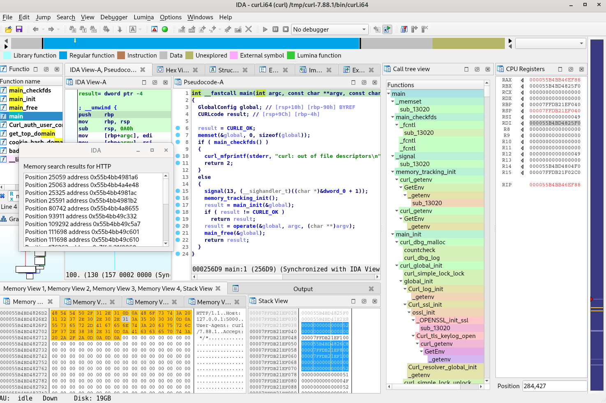

# Frinet

> By combining Frida with an enhanced version of Tenet, Frinet facilitates the study of large programs, vulnerability research and root-cause analysis on iOS, Android, Linux, Windows, and most architectures. [Blogpost on the Synacktiv website](https://www.synacktiv.com/publications/frinet-reverse-engineering-made-easier)

<p align="center">

</p>

This version is a complete rewrite of `synacktiv/frinet` (originally a fork of [gaasedelen/tenet](https://github.com/synacktiv/frinet/tree/legacy)).
You can still find the old version on the [legacy branch](https://github.com/synacktiv/frinet/tree/legacy).

This project was presented at SSTIC 2026 (in French) : [video/slides/paper](https://www.sstic.org/2026/presentation/spatial_frinet/).

The new archictecture is based on four components :
- `Indexer` : A Rust CLI that produces an optimized index from a trace file.
- `Backend` : A Rust crate that implements specialized algorihms to query the optimized index file.
- `Backend (Python bindings)` : A Rust crate that exposes a python interface.
- `IDA Plugin` : A thin layer of python code that queries and integrates data from the backend into the IDA interface.

## Features

**Tracer based on Frida**: Identical to the legacy version of Frinet.

**Indexer / Backend**:
- Efficient indexing of traces with up to 2 billion instructions (~100 GB).
- Independent of the trace format (only the Tenet format is supported for now).
- Multi-threaded memory search with full regex support.
- Usable as a standalone Rust library: `crates/db`.

**Frontend**: 
- Timeline / Register / Memory views.
- Call tree view (from the `.calls.txt` call list), synchronized with the timeline, with real IDA names or addresses.
- Graph view: flame chart of calls over time and call graph, both synchronized with the timeline.
- Story view: a generated narrative of the trace (API calls with decoded arguments) where every time and address is a link.
- Memory view follows the memory accesses of the current instruction; double-click a register to show it in memory.
- Assembly timeline trails (red/green/blue).
- Memory read/write breakpoint.
- Jump to first/prev/next/last execution.

### Missing features & TODOs

- Reach frontend feature parity with Frinet v1.
- UI polishing.
  
## Build & Installation

```bash
# Build the Python bindings shared lib
apt install python3-dev
cargo build --release
cp target/release/libfrinet_db.so frontend/frinet_db.so

# Symlink (or copy) the IDA Plugin
ln -s $PWD/frontend ~/.idapro/plugins/frinet
```

## Usage

```bash
# 1. Trace /bin/ls with frida
python tracer/trace.py spawn /bin/ls ls 0x4c00

# 2. Build an optimised index of the trace
cargo run --bin frinet --release -- index --format tenet tracer/traces/ls_xxxx.tenet ls.db

# 3. Open the trace in IDA (File > Load File > Open Frinet DB...)

# 4. Optional: open the call list (File > Load File > Open Frinet call tree / call graph / story...)
```

### Call list

Each trace gets a `<trace>.calls.txt` next to it (one line per call / API call / return,
with the line number in the `.tenet` file):

```
line=127          call sub_14000E424   @14000E8BC
line=185              api  KERNEL32!WriteFile   @14000E531
line=201          ret  -> 14000E8C1
```

- By default the tracer records it while tracing (x64 fast mode), no copy of the binary needed.
- `-X/--exe <binary>`: build it after tracing from the trace and a copy of the traced PE instead
  (`tracer/calltree.py` can also be used standalone). `--nocalls` disables it.

### Other tracer options

- `child` subcommand: attach to a parent process and trace the child it starts (`-c/--child <exe name>`).
- `-C/--cwd`: working directory for `spawn`.

## Testing & Fuzzing & Benchmark

```bash
cargo test

cargo install cargo-fuzz
cargo +nightly fuzz run --fuzz-dir crates/fuzz register_indexing

cargo install cargo-criterion
BENCH_DB=my.db cargo criterion
```