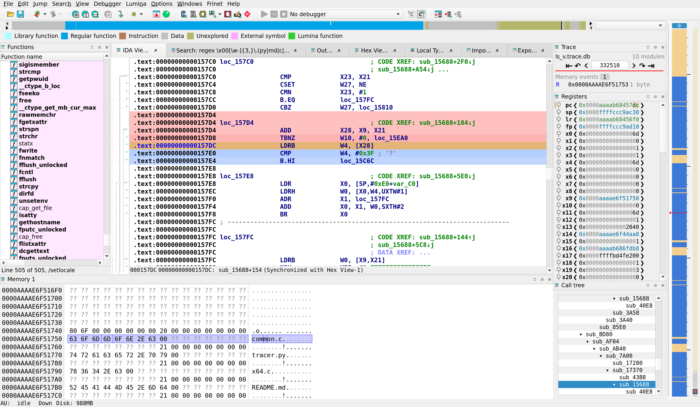
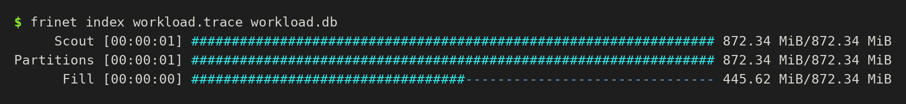
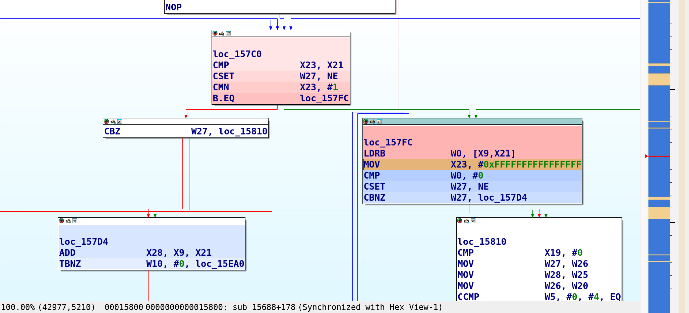
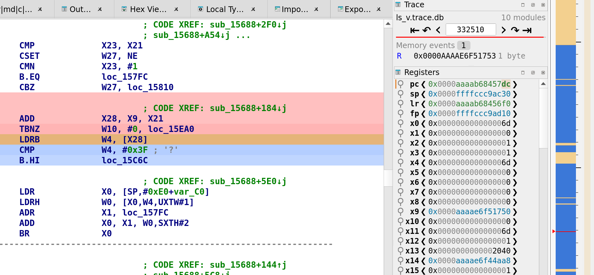
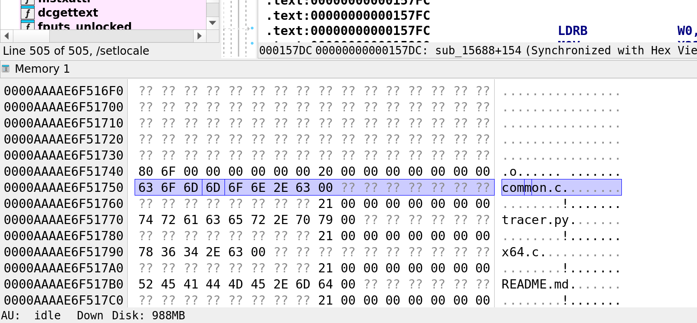
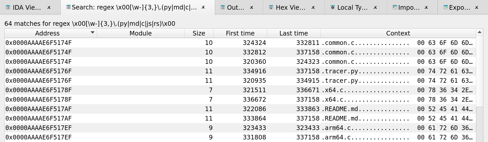
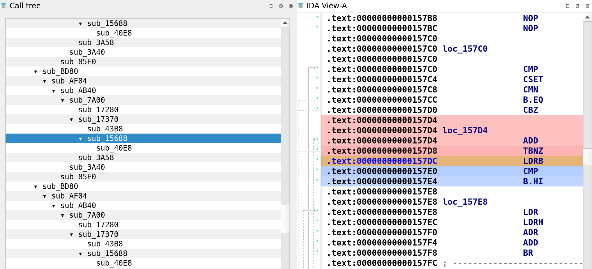
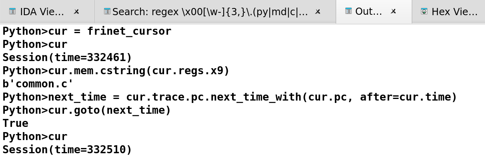

# Frinet



By combining Frida with an enhanced version of Tenet, Frinet eases the study of large programs,
vulnerability research and root-cause analysis on Linux, Android, iOS and Windows: record an
execution trace with Frida, then explore it in IDA (timeline, registers, memory and call tree),
over traces of up to 2 billion instructions.

This version is a complete rewrite of Frinet, originally a fork of
[gaasedelen/tenet](https://github.com/gaasedelen/tenet): the old version stays on the
[legacy branch](https://github.com/synacktiv/frinet/tree/legacy).
[Blogpost](https://www.synacktiv.com/publications/frinet-reverse-engineering-made-easier) ·
[SSTIC 2026 talk, in French](https://www.sstic.org/2026/presentation/spatial_frinet/) (video, slides, paper)

## Installation & usage

### Installation

```bash
hcli plugin install frinet
```

Or manually, in the Python interpreter IDA uses:

```bash
git clone https://github.com/synacktiv/frinet
cd frinet
pip install frinet
cp -r frontend ~/.idapro/plugins/frinet
```

### Usage

Trace a function with Frida (`pip install frida frida-tools`), here from `ls!0x4c00` until it
returns:

```bash
python tracers/frida/tracer.py -t ls -s 'ls!0x4c00' -f /bin/ls
```

Then open the trace in IDA (_File > Load file > Open Frinet trace or DB..._): it is indexed on
the way into `<trace>.db`, which IDA offers to reuse the next time.

To index a large trace ahead of time, without IDA, install the CLI indexer (Rust 1.89 or newer):

```bash
cargo install --git https://github.com/synacktiv/frinet frinet-cli
frinet index tracers/frida/traces/ls_<timestamp>_<tid>_0.trace ls.db
```

## Architecture

Entry points:

- **IDA plugin**: explore a trace right in IDA, next to the disassembly.
- **Python** (`frinet` package): script around your traces, one or many, with your own queries.
  The IDA plugin is built on it.
- **CLI** (`frinet index`): index a large trace ahead of time, without IDA. The DB is
  memory-mapped and read in place, so an indexed trace then opens instantly.



Rust modules:

- **Indexer** (`crates/index`)
    - turns a trace ([format](docs/TRACE_FORMAT.md)) into a DB
    - up to 2 billion instructions per trace
- **DB engine** (`crates/db`)
    - registers as time series, and every execution of an address from the PC
    - memory reads and writes in packed R-trees
    - multi-threaded memory search, with its own regex engine (`crates/regex`)
    - zero copy: the queries read the memory-mapped DB in place

Tests, fuzzing and benchmarks: [docs/TESTING.md](docs/TESTING.md).

## Features

**Timeline & trails**: past and future of each instruction



**Registers**: values and changes at each step



**Memory**: read/write breakpoints, first/prev/next/last access



**Search**: multi-threaded memory search with regex



**Call tree**: step over / step out



**Console**: `frinet_cursor`, the cursor the views follow



The `frinet` package also reads a DB outside IDA:

```python
import frinet

trace = frinet.open("ls.db")
ls = trace.module("ls")

# every execution of an instruction of ls, with the byte it loads
for time in trace.pc.times_with(ls.start + 0x157dc):
    state = trace.at(time)
    print(time, state.mem.read(state.regs.x28, 1))

# where and when "README.md" is in memory
for match in trace.search("README.md").result():
    print(hex(match.addr), match.first_time, match.last_time)
```
